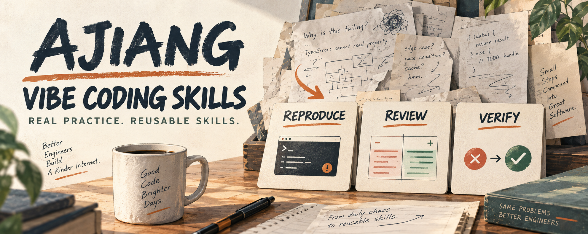
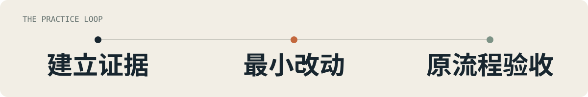

<p align="center">
  
</p>

# Ajiang Vibe Coding Skills

**程序员阿江日常 vibe coding 习惯的蒸馏。八个独立 skill，帮你把 AI 协作开发做得更有依据、更容易验收。**

<p align="center">
  <a href="#快速开始">安装</a> ·
  <a href="#按问题选-skill">Skill 目录</a> ·
  <a href="#这些-skill-从哪里来">来源</a> ·
  <a href="./evals/README.md">动手演练</a> ·
  <a href="./LICENSE">MIT</a>
</p>

## 从一个真实问题开始

你让 AI 修一个 bug，它改了代码、跑了检查。换回用户原来的环境，问题还在。

`ajiang_debugging` 会把这次协作拉回可验证的结果：区分现象和归因，先建立失败证据，找到原因后最小修复，再从原入口、原条件复测。

```text
使用 ajiang_debugging 调查这个 issue。
先核验报告里的现象和归因，修复后按原用户流程验证。
告诉我：原因是什么、什么证据支持它、哪些环境仍未验证。
```

同样的思路延伸到新功能、外部集成、代码审查、重构、上手和发版。每个 skill 都能单独使用，必要的方法和模板随它一起安装。

## 快速开始

在你要开发的项目目录中，通过 [Vercel Skills CLI](https://github.com/vercel-labs/skills) 安装：

```sh
npx skills add NanmiCoder/ajiang-vibe-coding-skills
```

交互选择需要的 skill 和 coding agent。也可以只装排障：

```sh
npx skills add NanmiCoder/ajiang-vibe-coding-skills --skill ajiang_debugging
```

全部安装到指定 agent：

```sh
npx skills add NanmiCoder/ajiang-vibe-coding-skills --skill '*' --agent codex
```

默认安装到当前项目；添加 `--global` 可安装到用户范围。需要 Node.js/npm 和能访问仓库的网络。技能内容本身不要求模型 API Key、MCP 或作者的其他 skill。

安装后，在 Codex 中可用 `$ajiang_debugging`，在 Claude Code 中可用 `/ajiang_debugging`；也可以在任务中直接写“使用 ajiang_debugging”。实际调用遵循你所用客户端的配置与权限。

## 按问题选 Skill

- [ajiang_feature_iteration](skills/ajiang_feature_iteration/SKILL.md) — 做新功能、迭代已有功能，完成最小用户路径与验收。
- [ajiang_debugging](skills/ajiang_debugging/SKILL.md) — 排查原因不明或修后仍复现的 bug，留下失败证据与原流程复测。
- [ajiang_contract_audit](skills/ajiang_contract_audit/SKILL.md) — 检查接口、配置、插件和同步，追到实际消费者与负向验证。
- [ajiang_adversarial_review](skills/ajiang_adversarial_review/SKILL.md) — 独立审查高影响改动，给出有触发条件的发现并逐条核验。
- [ajiang_ablation_refactor](skills/ajiang_ablation_refactor/SKILL.md) — 对膨胀代码做消融，用证据决定删、合并或保留。
- [ajiang_newcomer_acceptance](skills/ajiang_newcomer_acceptance/SKILL.md) — 按 README 和普通安装入口，验收新用户第一项真实成果。
- [ajiang_git_delivery](skills/ajiang_git_delivery/SKILL.md) — 明确范围提交、集成或创建 PR，在最新目标状态下验证。
- [ajiang_release_verification](skills/ajiang_release_verification/SKILL.md) — 核对版本、CI 和实际发布产物，确认用户拿到的结果。

只选当前问题需要的 skill。一次小改动不必启动所有流程；独立审查不必固定开四个 agent，内部逻辑测试也不必每次调用真实模型。

## 这些 Skill 从哪里来

我是[程序员阿江 / Relakkes](https://github.com/NanmiCoder)。这套 skill 来自最近几个月我和 AI 一起开发、迭代和维护软件的日常实践。

项目里的真实问题反复让我追问：你复现了吗？为什么认定是这个原因？独立审查发现的东西真的成立吗？别人按 README 能跑通吗？发布出来的包，真的包含这次修复吗？

这些问题和有效的解决方法，来自桌面 Agent、VoxAgent、TodoCue、MediaCrawler / MediaCrawlerPro，以及 DeepSeek Harness 插件等开发场景。我把其中可以迁移的习惯整理成独立 skill，补上输入、操作方法、证据、验收和工具不足时的处理方式，让别人在自己的项目里也能用。

开源的是重新编写的协作方法和原创练习。原始私密对话、账号凭证、作者本机配置不随仓库分发。部分方法的来源是历史会话整理材料；具体技术事实仍要在目标项目与版本中核验。详见[来源与整理边界](docs/ORIGIN.md)。

## 在一次迭代里怎么组合

<p align="center">
  
</p>

例如修一个 provider 问题，可以先用 `ajiang_debugging` 建立失败证据，再用 `ajiang_contract_audit` 跟踪实际配置和执行值；需要独立审查时加 `ajiang_adversarial_review`，已授权提交或发版时再使用对应交付 skill。

**每一步都以实际结果为依据。** 显示配置保存、进程仍在运行、AI 回复“已完成”，都不能单独代替用户任务成功。

## 没有同样的工具，也能开始

- 没有多 agent：可以用新会话或人工独立审查；单 agent 分视角自检会明确说明没有独立审查。
- 没有浏览器或桌面控制：先完成 CLI/协议层验收，再提供具体人工步骤，GUI 层保留未验证状态。
- 没有真实 API：内部流程可做确定性测试，真实服务行为单独标为未验证。

使用者需要具备目标项目本来要求的环境与资源。skill 不会替代模型、执行工具或权限，也不会因为安装而获得额外外部操作授权。

## 跑一次无 API Key 演练

仓库附带一个原创 Taskboard CLI：设置显示 `csv`，真实导出却没有遵循设置。它故意保留故障，用于练习复现、契约检查和原流程验收。

在一次性仓库副本中，让 agent 使用 `ajiang_debugging` 修复 `examples/taskboard`，再运行：

```sh
python3 evals/check_taskboard.py --project examples/taskboard
```

分发夹具预期 **3 项通过、2 项失败**；正确修复后应 **5 项通过**。检查读取实际导出文件，覆盖配置、环境变量、命令行优先级和数据内容。它是教学夹具，不是生产级可靠性证明。

[完整演练提示与评估方式](evals/README.md) · [已验证范围](docs/VALIDATION.md)

<details>
<summary>仓库维护与贡献</summary>

每个 skill 位于 `skills/ajiang_xxx/`，包含 `SKILL.md`、本地模板及许可证，可独立安装。格式采用 Vercel Skills CLI 可发现的 Markdown + YAML frontmatter 布局；`ajiang_` 名称以实际 CLI 安装测试为依据。

修改后运行离线检查：

```sh
python3 scripts/validate_skills.py
```

贡献时附一个可复现的任务、目标环境、修前修后结果和方法差异。优先窄修复，不把一次失败变成所有任务的永久规则。不要提交凭证、用户日志或个人绝对路径。

安装文件验证和 agent 实际任务效果分别记录；目前不宣称所有宿主、模型与平台均已通过行为测试。

</details>

## License

[MIT](LICENSE) · 每个 skill 目录都保留许可，便于独立复制与分发。
