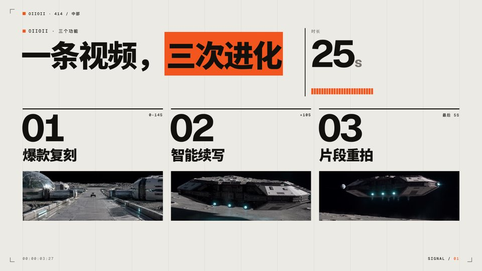
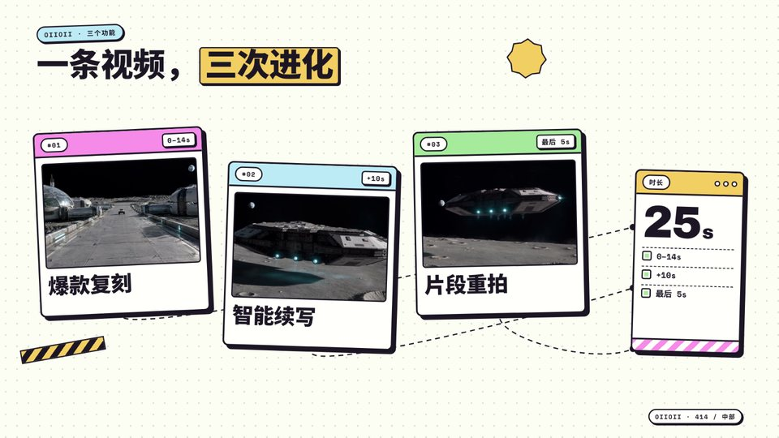
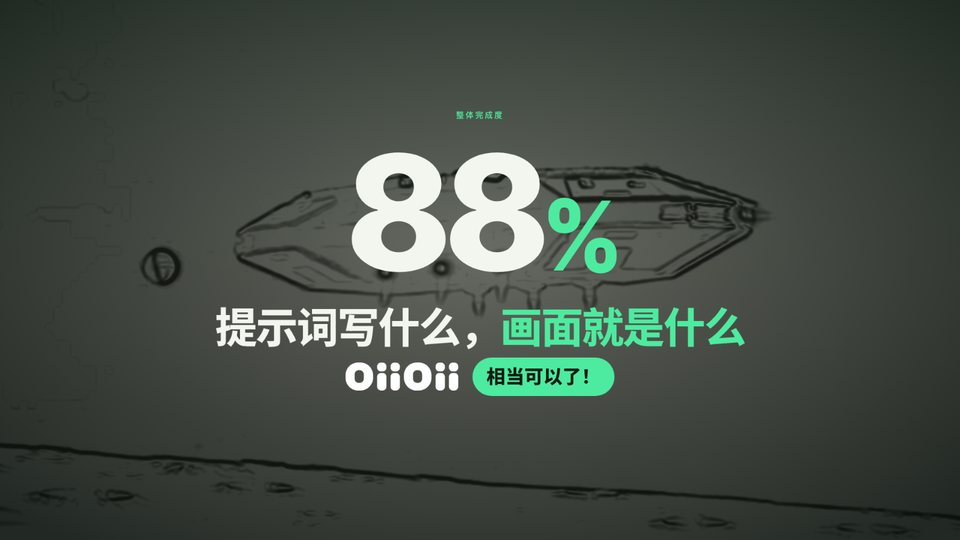
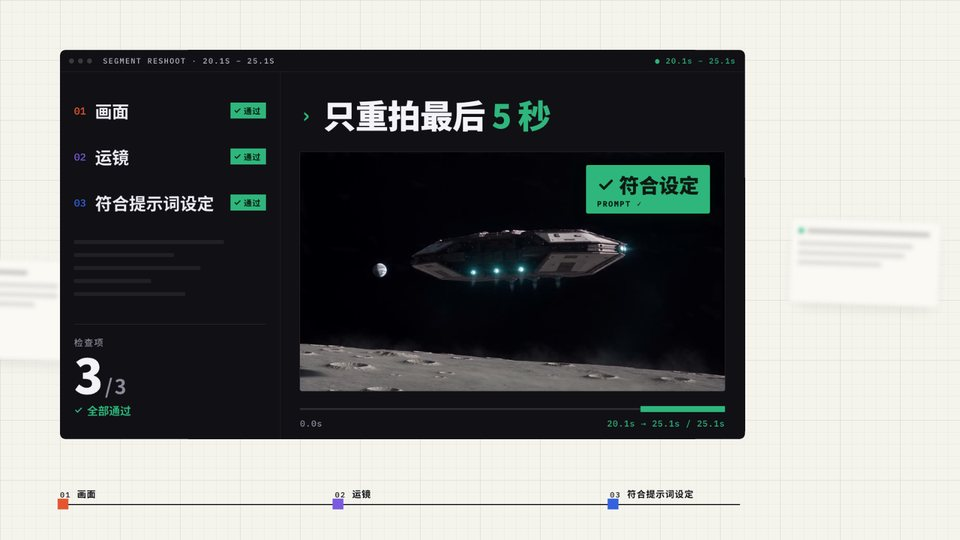
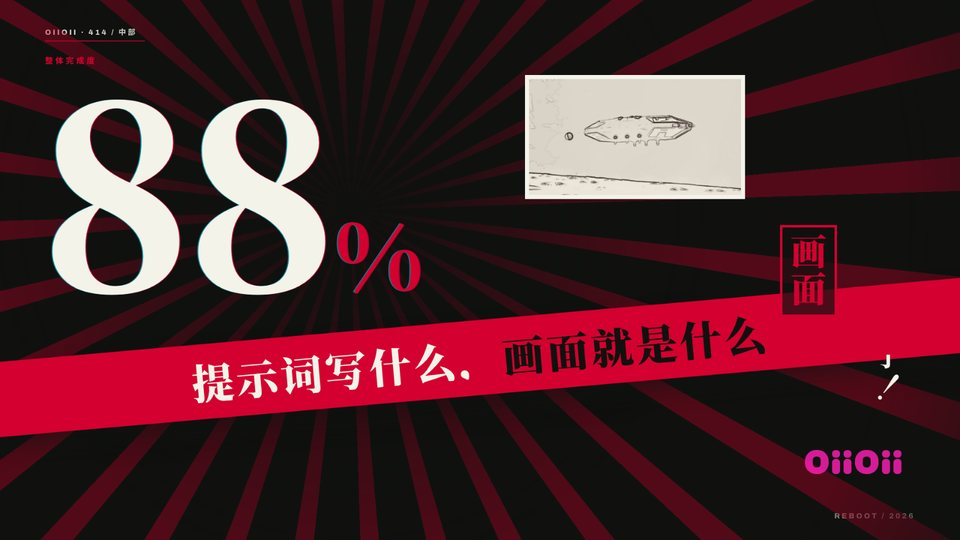
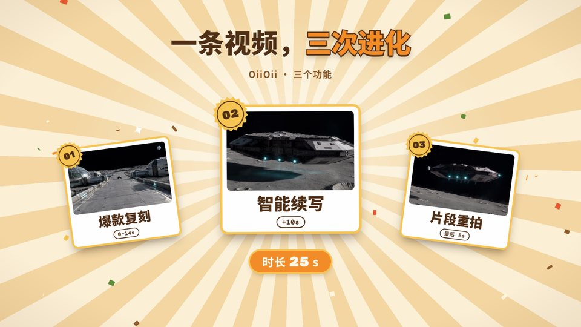
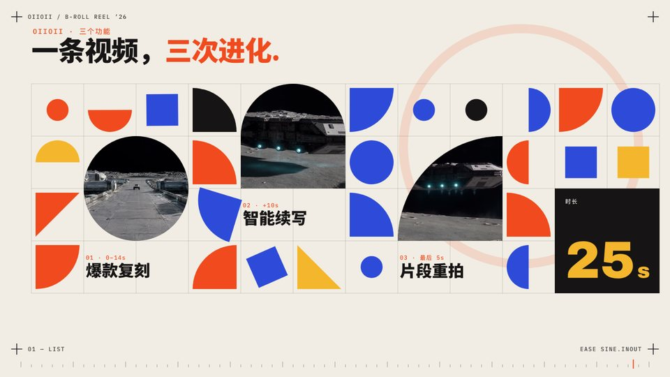

<p align="center">
  
</p>

# Ajiang Vibe Coding Skills

**程序员阿江日常 vibe coding 习惯的蒸馏。五个常用 skill：排查 bug、审查代码、开发功能、消融实验、提交代码；另附一个做口播视频 B-roll 的 skill，带 10 套动画模板。**

<p align="center">
  <a href="#快速开始">安装</a> ·
  <a href="#按问题选-skill">Skill 目录</a> ·
  <a href="#视频-b-roll-模板">B-roll 模板</a> ·
  <a href="#我常用的其他-skills">其他常用 Skills</a> ·
  <a href="#这些-skill-从哪里来">来源</a> ·
  <a href="./LICENSE">MIT</a>
</p>

## 从一个真实问题开始

你让 AI 修一个 bug，它改了代码、跑了检查。换回用户原来的环境，问题还在。

`ajiang-debug` 会把这次协作拉回可验证的结果：区分现象和归因，先建立失败证据，找到原因后最小修复，再从原入口、原条件复测。

```text
使用 ajiang-debug 调查这个 issue。
先核验报告里的现象和归因，修复后按原用户流程验证。
告诉我：原因是什么、什么证据支持它、哪些环境仍未验证。
```

每个 skill 都可以单独安装、单独使用，按当前任务选择即可。

## 快速开始

在你要开发的项目目录中，通过 [Vercel Skills CLI](https://github.com/vercel-labs/skills) 安装：

```sh
npx skills add NanmiCoder/ajiang-vibe-coding-skills
```

交互选择需要的 skill 和 coding agent。也可以只装排障：

```sh
npx skills add NanmiCoder/ajiang-vibe-coding-skills --skill ajiang-debug
```

全部安装到指定 agent：

```sh
npx skills add NanmiCoder/ajiang-vibe-coding-skills --skill '*' --agent codex
```

默认安装到当前项目；添加 `--global` 可安装到用户范围。需要 Node.js/npm 和能访问仓库的网络。技能内容本身不要求模型 API Key、MCP 或作者的其他 skill。

安装后，在 Codex 中可用 `$ajiang-debug`，在 Claude Code 中可用 `/ajiang-debug`；也可以在任务中直接写“使用 ajiang-debug”。实际调用遵循你所用客户端的配置与权限。

## 按问题选 Skill

| Skill | 用途 |
|---|---|
| [ajiang-debug](skills/ajiang-debug/SKILL.md) | 排查和修复 bug：先复现、验证原因，修复后按原操作流程复测 |
| [ajiang-review](skills/ajiang-review/SKILL.md) | 审查代码：找出真实缺陷和回归风险，给出位置、触发条件与证据 |
| [ajiang-feature](skills/ajiang-feature/SKILL.md) | 开发新功能：实现用户要完成的操作，从实际入口验证结果 |
| [ajiang-ablation](skills/ajiang-ablation/SKILL.md) | 做消融实验：每次移除或替换一个机制，对比效果与成本，判断是否保留 |
| [ajiang-git-commit-pr](skills/ajiang-git-commit-pr/SKILL.md) | 提交代码、创建 PR；创建前同步最新上游，检查文本与业务冲突 |
| [ajiang-video-broll](skills/ajiang-video-broll/SKILL.md) | 给口播视频做整屏 B-roll / MG 包装：按字幕选段，套 10 套模板之一，预览确认后用 Remotion 渲染 4K |

## 视频 B-roll 模板

`ajiang-video-broll` 给初剪好的口播视频做整屏 B-roll / MG 包装：读 SRT 选出要包装的段落，选一套模板写场景；先出一个和成片同一套引擎的预览页，确认后再用 Remotion 渲染 4K，配上这套模板的音效和配乐，按字幕时间命名交付，直接替换剪辑时间线上的视频轨。

10 套模板的版式、构图、动效编排、配色和声音各不相同，换模板不只是换颜色。下面每张图都是同一段演示内容在各套模板里的样子。

### 本地预览全部模板

```sh
git clone https://github.com/NanmiCoder/ajiang-vibe-coding-skills.git
cd ajiang-vibe-coding-skills
python3 skills/ajiang-video-broll/assets/gallery/serve.py
```

浏览器会打开 http://127.0.0.1:8765/ 。在页面上可以切换模板和配色变体、拖动时间轴、单独回放每个动效、试听音效和配乐；`?id=riso-print&t=6` 这样的参数可以直接定位到某套模板的某一秒。

需要 Python 3 和 Node.js，字体从 Google Fonts 加载。试听音频要额外装 `pip install numpy scipy soundfile pyloudnorm` 和 ffmpeg，第一次启动时自动生成，大约 30 秒；不装也能看动画。端口被占用时加 `--port 9000`。

### 10 套模板

<table>
<tr>
<td width="50%" valign="top"><br><b>纸白信号橙</b> <code>paper-signal</code><br>默认主选。瑞士海报网格、巨号索引数字、橙色扫描条<br><sub>适合：产品发布、功能清单、观点</sub></td>
<td width="50%" valign="top"><br><b>贴纸波普</b> <code>sticker-pop</code><br>粗描边彩色窗口 + 流动虚线连线<br><sub>适合：痛点到方案、吐槽式教程</sub></td>
</tr>
<tr>
<td width="50%" valign="top"><br><b>黑白薄荷</b> <code>mint-switch</code><br>黑白整屏硬切，只用一个薄荷绿<br><sub>适合：原理讲解、分步骤、Agent 演示</sub></td>
<td width="50%" valign="top"><br><b>暖雾</b> <code>warm-haze</code><br>镜头在大号产品界面上漂移，暖色雾团<br><sub>适合：产品 demo、上手教程</sub></td>
</tr>
<tr>
<td width="50%" valign="top"><br><b>便签复盘</b> <code>sticky-audit</code><br>证据墙：碎片被扫描线逐个对焦、编号、连线<br><sub>适合：工作流、排查、从乱到有序</sub></td>
<td width="50%" valign="top"><br><b>孔版印刷</b> <code>riso-print</code><br>错位套印色带、印版换页、维恩叠色<br><sub>适合：三个要点、A 对 B、轻松介绍</sub></td>
</tr>
<tr>
<td width="50%" valign="top"><br><b>昭和海报</b> <code>showa-poster</code><br>特摄标题卡：巨字硬切、放射线、竖排、红幅<br><sub>适合：单字点题、重磅消息、翻车开场</sub></td>
<td width="50%" valign="top"><br><b>复古旭日</b> <code>retro-sunburst</code><br>对称庆典海报：旋转光芒、锯齿徽章、撒花<br><sub>适合：里程碑、榜单、致谢</sub></td>
</tr>
<tr>
<td width="50%" valign="top"><br><b>彩卡拼贴</b> <code>color-cards</code><br>饱和色卡逐张推进，最后收成倾斜拼贴<br><sub>适合：功能枚举、案例墙</sub></td>
<td width="50%" valign="top"><br><b>包豪斯几何</b> <code>bauhaus-grid</code><br>几何形网格，图片裁成几何形<br><sub>适合：结构、模块、架构设计</sub></td>
</tr>
</table>

## 我常用的其他 Skills

点击名称查看项目与安装方式。

| Skill | 用途 | 来源 |
|---|---|---|
| [design-taste-frontend](https://github.com/Leonxlnx/taste-skill) | 提升 UI 设计品味，改善布局、字体与动效 | Leonxlnx |
| [ui-ux-pro-max](https://github.com/nextlevelbuilder/ui-ux-pro-max-skill) | 搜索配色、字体组合、设计风格与 UX 规则 | nextlevelbuilder |
| [ego-browser](https://lite.ego.app/) | 操作真实浏览器，截图、提取数据、验证网站 | Ego Lite |
| [voice-clone-tts](https://github.com/NanmiCoder/creator-pipeline/tree/main/skills/voice-clone-tts) | 用自己的声音生成配音与字幕 | 阿江改造维护 |
| [web-video-presentation](https://github.com/NanmiCoder/creator-pipeline/tree/main/skills/web-video-presentation) | 把口播与字幕做成网页视频演示，导出 MP4 | 阿江改造维护 |

后两个可以配合使用：先生成配音与字幕，再按声音节奏制作画面。

## 这些 Skill 从哪里来

我是[程序员阿江 / Relakkes](https://github.com/NanmiCoder)。这套 skill 来自最近几个月我和 AI 一起开发、迭代和维护软件的日常实践。

项目里的真实问题反复让我追问：你复现了吗？为什么认定是这个原因？独立审查发现的东西真的成立吗？别人按 README 能跑通吗？发布出来的包，真的包含这次修复吗？

这些问题和有效的解决方法，来自桌面 Agent、VoxAgent、TodoCue、MediaCrawler / MediaCrawlerPro，以及 DeepSeek Harness 插件等开发场景。我把其中可以迁移的习惯整理成独立 skill，补上输入、操作方法、证据、验收和工具不足时的处理方式，让别人在自己的项目里也能用。

开源的是重新编写的协作方法和原创练习。原始私密对话、账号凭证、作者本机配置不随仓库分发。部分方法的来源是历史会话整理材料；具体技术事实仍要在目标项目与版本中核验。详见[来源与整理边界](docs/ORIGIN.md)。
